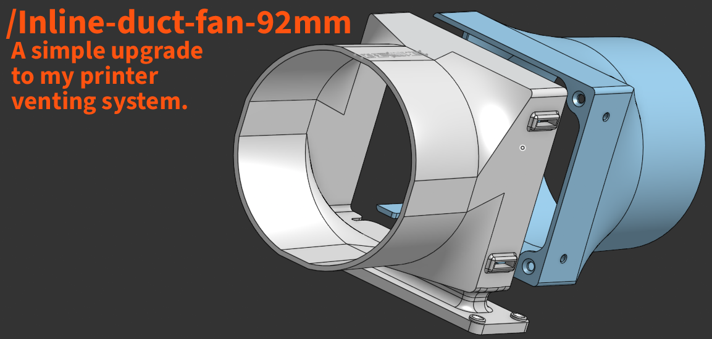

# inline-duct-fan-92mm
A printable inline duct fan with an integrated wall mount. Fits a 92mm fan and 100mm duct.

| | |
|---|---|
| **Status** | Prototype, Unprinted |
| **Current version** | v1.0 |
| **Designed in** | [Onshape CAD](https://cad.onshape.com/) |
| **Printer** | [BambuLabs X2D](https://bambulab.com/en-us/x2d/specs) |
| **Material** | Planned: [PETG (BambuLabs PETG Basic, Black)](https://ca.store.bambulab.com/products/petg-basic?srsltid=AYCX9vJIllUZIcUNaHjtEjqU0uf3pZljnNwnhr9AaGkRu96E9yLFgfSL&id=703075596700733453) |
| **Material - Upgrade** | Planned: [ASA (BambuLabs ASA, Black)](https://ca.store.bambulab.com/products/asa-filament?srsltid=AYCX9vIWgAQo21p7wsp688ybQI1Y6ie9Yu8FBUoQWvgQGcLdpOcmOGGg&id=44173925712112) |

## Overview

I upgraded to a printer capable of engineering materials (ASA, ABS, and nylon), on the condition that it be vented out of the house. These materials release [VOC](https://pubmed.ncbi.nlm.nih.gov/40341722/)s during printing, and several people in the household are sensitive to the odor, so exhaust was a requirement rather than an option. This design is an inline duct fan mount that actively pulls contaminated air out of the enclosure and through the ducting, with the goal of keeping the workshop odor-free after prints.

## Key Design Features

1. **Internal Fan Enclosure:** Enclose Fan completely, to allow for least amount of air leakage as possible.
2. **Inline Fan Installation:** Utilize current 100mm venting duct assemblies.
3. **Fan Depth Agnostic:** Allows for different fan depths by allowing for sliding friction fit adjustment. This also allows for future addition of TPU printed gaskets to improve air seal around fan.
4. **Ease of installation:** Built in design for 100mm bodies to draft by 1.5 degrees allow for easy 100mm duct fitment, and easy fitment onto existing hardbody 100mm duct (for appropriate printed bodies)

## Print Settings

| Setting | Value |
|---|---|
| Printer | [BambuLabs X2D](https://bambulab.com/en-us/x2d/specs) |
| Material | Planned: [PETG (BambuLabs PETG Basic, Black)](https://ca.store.bambulab.com/products/petg-basic?srsltid=AYCX9vJIllUZIcUNaHjtEjqU0uf3pZljnNwnhr9AaGkRu96E9yLFgfSL&id=703075596700733453) |
| Nozzle | 0.4 mm |
| Layer height | 0.20mm |
| Infill | 15% Gyroid |
| Walls / perimeters | 4 |
| Supports | Normal (Auto), Snug, 45° Threshoold Angle, On Build Plate only|
| Orientation | Auto Orientation (BambuLabs Studio) |
| Print time | 10h43m |
| Material Cost | 85.73m / 257.76 g |
| Material Cost (Support) | 11.71m / 35.20g |
| Wastage | 13.67% |

## Bill of Materials

| Item | Qty | Notes |
|---|---|---|
| 3D printed bodies | 2 | |
| Heat-Press Inserts | TBD | Size TBD |
| Bolts and Washers | TBD | Size TBD |
| Fab | TBD | 92mm |

## Assembly

TODO

<!--
1. [Step]
2. [Step]
3. [Step]
-->

## Design Considerations & Lessons Learned

- Tolerance, Warping, Fitment
TODO

- Failures and Changes
TODO

- Future Design Considerations
TODO

For more detail, see [Design Notes](docs/design-notes.md).

## Revision History

| Version | Date | Changes |
|---|---|---|
| v1.0 | [2026-11] | Initial release |

## Files
TODO

- `cad/`: native CAD files (editable)
- `stl/`: print-ready exports
- `images/`: photos and renders
- `docs/`: extended notes

## License

[CC BY 4.0 / MIT]. See [LICENSE](LICENSE).
